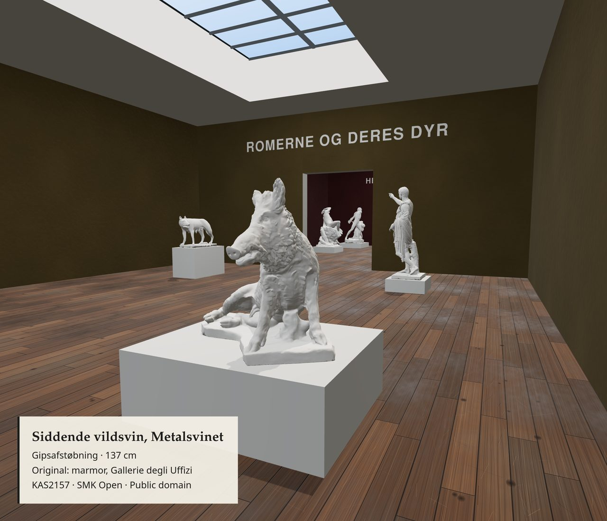
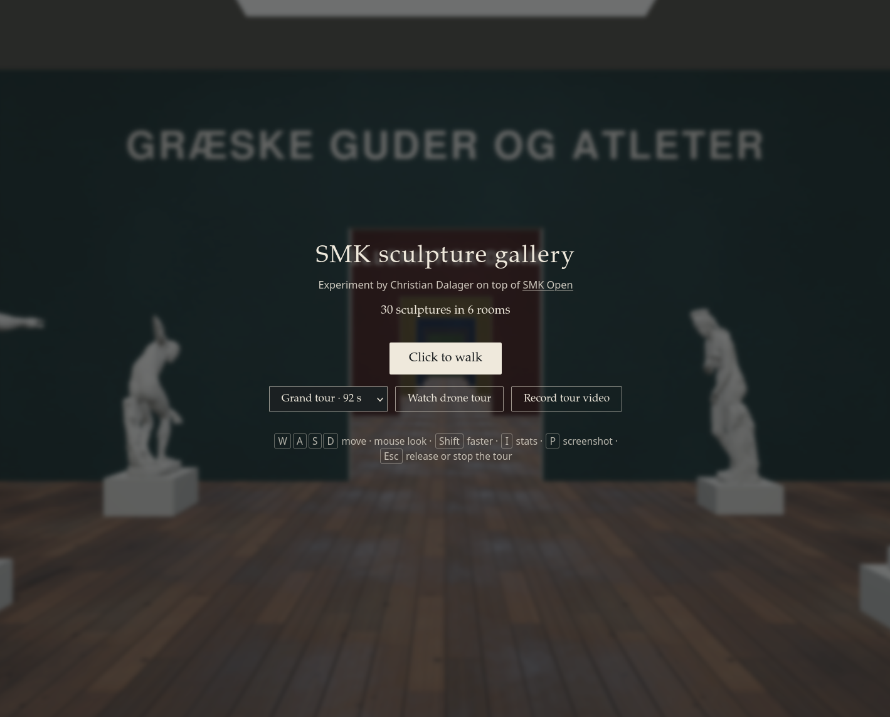

# SMK sculpture gallery



A virtual sculpture gallery you can walk through in the browser, built from the
3D scans that [Statens Museum for Kunst](https://www.smk.dk/) publishes through
[SMK Open](https://open.smk.dk/). Thirty sculptures stand in six skylit rooms;
you can stroll around them in first person, watch a scripted drone tour, or
render that tour to an MP4.

An experiment by Christian Dalager on top of SMK Open.

## Quick start

Needs Node.js (developed on v25) and, for recording video, a browser with
WebCodecs (tested in Chrome).

```bash
npm install
npm run assets   # download the scans from SMK and convert them (about 560 MB of downloads)
npm run dev      # start the viewer; also reachable from other devices on the LAN
```

The converted models are not checked in, so `npm run assets` has to run once
before the viewer shows anything.

| Command | What it does |
|---|---|
| `npm run assets` | Build every sculpture listed in `config/sculptures.json` |
| `npm run assets -- KAS83 KAS37` | Rebuild only those, keeping the rest |
| `npm run dev` | Development server |
| `npm run build` / `npm run preview` | Production build into `dist/` and a server for it |
| `npm test` | Unit tests (Node's built-in test runner) |

## Features



- **First-person walking.** Mouse look and WASD, with collision against walls,
  door frames and plinths. Shift to go faster, `I` for a frame-rate readout.
- **Screenshots.** `P` saves the current view as a PNG while you walk or during
  a tour, with the plaque if one is showing but without the other on-page
  overlays.
- **Six rooms in a row**, joined by doorways on a central axis, each with its own
  wall colour and its title lettered above the door openings.
- **Sculptures at real size**, each on a plinth sized to its base, lining the
  aisle and facing it. Plaster, marble, bronze and sandstone get different
  surfaces.
- **Plaques** in Danish with title, artist, material, height and, for plaster
  casts, the material and owner of the original. A plaque comes up for the piece
  you are looking at.
- **Skylights** over every room, and lighting built around them: soft light from
  above with shadows at the foot of each piece.
- **Worn plank floor and plaster walls**, drawn in code at start-up; there are no
  image files.
- **Detail on demand.** Every sculpture exists at three levels of detail. Only
  the coarsest loads at start (3.9 MB for all thirty); finer ones load as you
  approach.
- **Drone tours.** A grand tour (about 92 s) strolls every room; a quick tour
  (about 45 s) strolls the first room, hurries through the rest and ends looking
  back down the whole gallery. Plaques appear as the camera turns to each piece.
- **Video recording.** Either tour can be rendered frame by frame to an H.264
  MP4, plaques included. Because each frame is drawn for its exact timestamp, the
  result is smooth regardless of how fast the machine is.

### Address options

| Address | Effect |
|---|---|
| `?tour` | Start the tour as soon as the page has loaded |
| `?record` | Start recording as soon as the page has loaded |
| `&route=quick` | Use the quick tour instead of the grand tour |
| `&size=1080x1350` | Video size (default `1920x1080`) |
| `&fps=60` | Frame rate (default 30) |
| `&duration=60` | Stretch or squeeze the tour to this many seconds |
| `?cam=x,z,yaw` | Start standing at a given spot, facing a given direction in degrees |

## The asset pipeline

`scripts/build-assets.mjs` turns museum scans into models a browser can load
quickly. The scans are STL files of roughly 400,000 triangles and 20 MB each: no
units, no agreed orientation, no compression.

For each sculpture in `config/sculptures.json` it:

1. **Fetches the catalogue record** from the SMK API: title, artist, materials,
   dimensions, rights, and details of the original for casts.
2. **Gets the STL**, from a local file if the config names one, otherwise by
   downloading the smallest one the API offers into `.cache/`. SMK's server drops
   connections after a few megabytes, so downloads resume until complete.
3. **Works out which way is up** by comparing the scan's proportions with the
   catalogue's height, width and depth. The config can override this (`"up"`).
4. **Turns the piece to face forward** if the config gives a `"rotateY"`.
5. **Scales to real size** from the catalogue height, stands the piece on the
   floor and centres it on its own base, so an outstretched arm does not push a
   figure off its plinth.
6. **Welds** the scan's duplicate vertices, **simplifies** to three levels of
   detail (full, 100,000 and 20,000 triangles), computes smooth normals, and
   writes each as a meshopt-compressed GLB.
7. **Writes `public/gallery.json`** with the rooms and everything the viewer needs
   to place and label each piece.

A 20 MB STL becomes about 2.3 MB at full detail and 0.13 MB at the coarsest. All
thirty at full detail come to 68.6 MB.

### Adding or adjusting a sculpture

Add an entry to `config/sculptures.json` with the SMK object number and a room:

```json
{ "objectNumber": "KAS434", "room": "greek" }
```

then run `npm run assets -- KAS434`. If it comes out lying down or facing the
wall, add `"up": "z"` (or `"x"`, `"y"`) or `"rotateY": 90` and run it again.
Object numbers containing a slash, such as `KAS112/2`, are not supported yet.

To find candidates, the API lists everything with a 3D file:
`https://api.smk.dk/api/v1/art/search/?keys=*&filters=[has_3d_file:true]`

The agent skills in [`skills/`](skills/README.md) wrap this: one searches SMK's
3D-scanned sculptures, the other walks through designing rooms and checks a config
against the API and the floor plan before you build it.

## Hosting as a static website

The built gallery is plain files: no server code, no database, nothing fetched
from SMK while it runs.

```bash
npm run assets   # once, if public/models is not built yet
npm run build    # writes the whole site to dist/
```

Upload the contents of `dist/` to any static host (GitHub Pages, Cloudflare
Pages, Netlify, S3, a folder on your own web server). All paths are relative, so
it works at a domain root or in a sub-folder without configuration.

Things to know before you do:

- **Size.** `dist/` is about 89 MB in 95 files, nearly all of it the models. The
  largest single file is 4.8 MB, which is within the per-file limits of the
  usual static hosts.
- **Bandwidth.** A visitor downloads about 5 MB to start, and more only for the
  sculptures they walk up to. Watching or recording a full tour pulls in most of
  the 89 MB.
- **HTTPS for recording.** Browsers only allow video encoding on secure pages, so
  "Record tour video" needs `https://` (or `localhost`). Walking and watching
  tours work over plain `http://` too, which is why recording fails when you open
  the dev server from another device on the LAN.
- **Caching.** Model file names do not change when a model is rebuilt. If you
  rebuild a sculpture and redeploy, visitors may see the old one until their
  cache expires, unless the host is set to revalidate `models/` and
  `gallery.json`.

## Tech stack

| Part | Used for |
|---|---|
| [three.js](https://threejs.org/) | Rendering, model loading, pointer-lock controls, area lights |
| [Vite](https://vite.dev/) | Development server and production build |
| [glTF Transform](https://gltf-transform.dev/) | Welding, simplifying and writing GLB in the pipeline |
| [meshoptimizer](https://meshoptimizer.org/) | Simplification and mesh compression; its decoder runs in the browser |
| [Mediabunny](https://mediabunny.dev/) | Encoding and writing the MP4, loaded only when recording |
| Canvas 2D | Floor, wall, sky and lettering textures, and plaques on video frames |
| Node.js test runner | Unit tests, no test framework |

Plain JavaScript modules throughout; no UI framework.

## Project layout

```
config/sculptures.json   rooms, sculptures and detail levels
scripts/                 the asset pipeline and its resumable downloader
src/lib/                 pure logic, no DOM or three.js: STL parsing, mesh maths,
                         floor plan, collision, noise, tour paths
src/                     the viewer: rooms, skylights, textures, signage,
                         sculptures, walking, plaques, tours, recording
tests/                   unit tests for everything in src/lib
public/                  generated models and gallery.json (not checked in)
```

The split matters: everything in `src/lib` runs under Node, so the floor plan,
collision and camera paths are tested without a browser. The tests check, among
other things, that a visitor can walk the whole enfilade and that neither tour
ever flies through a wall, door frame or plinth.

## Limitations

- Desktop only: walking needs a mouse and keyboard; there are no touch controls.
- The daylight is faked rather than simulated; no sun patch moves across the floor.
- Wall lettering uses the system's Helvetica: the real thing on macOS, Nimbus Sans
  on Linux, Arial on Windows.
- Recorded videos have no sound.

## Data and rights

The sculptures, scans and catalogue data come from SMK Open. The pipeline records
each object's rights statement, and all thirty pieces in the default selection are
marked public domain by SMK. Plaques link back to each object's page on
[open.smk.dk](https://open.smk.dk/).
